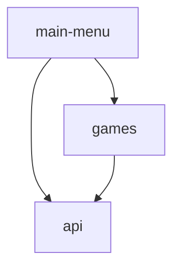

# ミニゲームコレクション (Game Bundle)

コンソール上で遊べるミニゲームをまとめた Java アプリケーションです。
新しいゲームを容易に追加できる**プラグイン型の拡張性**と、責務を明確に分離した **Gradle マルチプロジェクト構成**を意識して設計・開発しました。

---

## 1. 技術スタック・開発環境

* **言語**: Java 21（`record`、テキストブロック、`switch` 式などのモダンな機能を活用）
* **ビルドツール**: Gradle（マルチプロジェクト構成 ＋ `build-logic` による Convention Plugins）
* **テスト**: JUnit Jupiter 6.0.1

---

## 2. アーキテクチャとモジュール構成

各機能の依存関係を疎結合に保つため、役割ごとにサブプロジェクトを分割しています。

```text
game-bundle/
├── api/          # 共通インターフェース（GameInterface）および安全なコンソール入力基盤
├── games/        # 各ミニゲームの具体的な実装（HighLow など）とゲーム登録管理
├── main-menu/    # エントリーポイントおよびメニュー画面の制御
└── build-logic/  # サブプロジェクト間で共通するGradleビルド設定（Convention Plugins）の一元管理
```

### モジュール間の依存関係



* **`main-menu` は個別のゲームクラス（`HighLow` など）に直接依存しません。**
* `GameRegistry` を通じて `GameInterface` 型のリストとしてゲームを取得するため、新しいゲームを追加してもメニュー側のコードを修正する必要がありません（開放閉鎖の原則）。

---

## 3. 設計上のこだわり・工夫した点

### ① 入力処理とバリデーションの完全分離（単一責任の原則）
* **`InputValidator`**: 文字列の空白・数値変換・範囲チェックを行う純粋なロジッククラスです。検証結果は Java の `record`（`ValidationResult`）を用いて不変オブジェクトとして返却し、I/O処理を持たないため単体テストが容易な設計にしています。
* **`ConsoleInput`**: `Scanner.nextLine()` をベースに、正しい値が入力されるまで再入力を求めるラッパークラスです。`nextInt()` 特有の改行コード残留バグを防ぎます。

### ② 依存性注入（DI）によるリソース管理とテスト容易性
* `Scanner(System.in)` のインスタンスはエントリーポイント（`MainMenu`）で1度だけ生成し、コンストラクタ経由で `ConsoleInput` や各ゲームへ渡しています。
* これにより、`System.in` の多重生成による競合・クローズ事故を防ぎつつ、テスト時には擬似入力を注入（モック化）しやすい構造にしています。

### ③ `build-logic` によるビルド設定の共通化
* サブプロジェクトが増えた際の `build.gradle` の記述重複やバージョン不整合を防ぐため、`build-logic` に共通設定（Convention Plugins）を切り出しています。
* `main-menu` の `run` タスクには `standardInput = System.in` を設定済みのため、ビルドツール経由でもスムーズに対話的なコンソール操作が可能です。

---

## 4. 実行方法

リポジトリをクローン後、プロジェクトのルートディレクトリで以下のコマンドを実行してください。

### リポジトリのクローンと移動
ターミナル（またはコマンドプロンプト）を開き、以下のコマンドでリポジトリをクローンしてプロジェクトディレクトリへ移動します。
```bash
git clone https://github.com
cd GameBundle
```

### アプリケーションの起動
```bash
./gradlew :main-menu:run
```
※Windows（コマンドプロンプト / PowerShell）の場合は `./gradlew` を `gradlew.bat` に置き換えてください。
### ビルドおよびテストの実行
```bash
./gradlew check
```

---

## 5. 実行イメージ（プレイ画面例）

```text
---------------------
ミニゲームコレクション
---------------------
   |1:   HighLowゲーム

遊びたいゲームの番号を入力してください
終了する場合は0を入力してください
==>1

HighLowゲームを開始します

現在のカード: 7 / 残りのカード枚数:12枚 / 勝利数 0
次のカードは7より高い？低い？
（高い: 1/低い: 2）==>1
-- WIN! --
```

---

## 6. 新しいゲームの追加手順

1. `games` モジュール内に `GameInterface` を実装（`implements`）した新しいゲームクラスを作成します。
2. `GameRegistry#createGameList()` のリストに、作成したゲームクラスのインスタンスを追加します。
3. アプリを起動すると、自動的にメニュー一覧へ反映されます。

---

## 7. 今後の展望（ロードマップ）

* [ ] 単体テスト（JUnit Jupiter）の拡充（`InputValidator` の境界値テスト、`ConsoleInput` の擬似入力テストなど）
* [ ] ミニゲームの追加（数当てゲーム、ブラックジャックなど）
* [ ] `java.util.ServiceLoader` を用いた完全な動的プラグイン読み込みへの移行
* [ ] GitHub Actions を用いたプッシュ時の自動ビルド・テスト（CI）の導入
